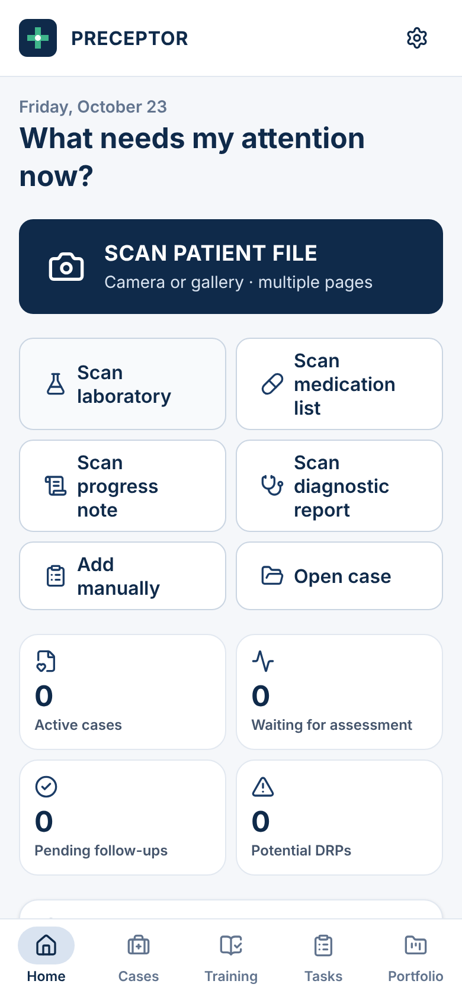
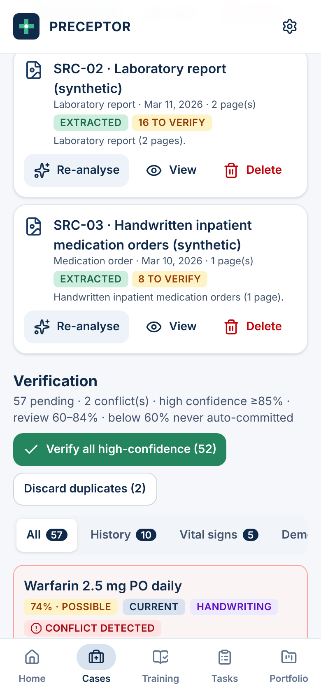
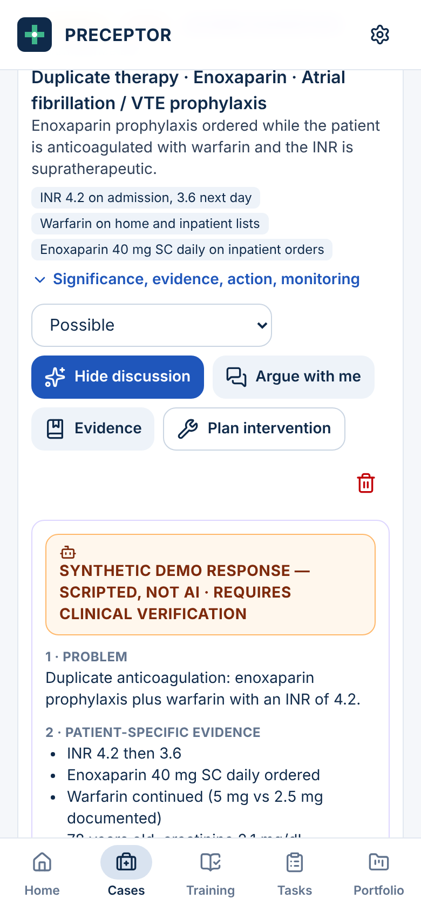
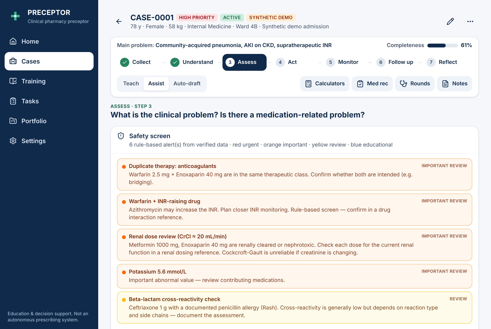

# PRECEPTOR — Digital Clinical Pharmacy Preceptor

An AI clinical-pharmacy rotation copilot that teaches trainees to **think like a hospital clinical pharmacist**. It is a standalone full-stack web app / installable PWA with a secure multi-provider AI backend (**Gemini**, **DeepSeek**, **Kimi**, **OpenAI**, **Claude**) with automatic failover, packaged for Android with Capacitor.

```
COLLECT → UNDERSTAND → ASSESS → ACT → MONITOR → FOLLOW UP → REFLECT
"What do I know?"  "What is happening?"  "Is there a medication-related problem?"  "What should I do?"
"What should I watch?"  "When should I reassess?"  "What did I learn?"
```

| Home (phone) | Verification with conflict (phone) | DRP clinical discussion (phone) |
|---|---|---|
|  |  |  |



> **Clinical safety.** PRECEPTOR is for clinical pharmacy **education and decision support**. It is not an autonomous prescribing system. Every AI output is labelled *AI-GENERATED DRAFT · REQUIRES CLINICAL VERIFICATION*; the trainee and supervising clinicians remain responsible for every decision. Use synthetic or properly authorised, de-identified data only.

---

## Quick start

Requirements: **Node.js ≥ 22.13** (for the built-in `node:sqlite`), npm.

```bash
npm install
cp .env.example .env          # then add GEMINI_API_KEY, DEEPSEEK_API_KEY and/or KIMI_API_KEY (server-side only)
npm run dev                   # web app on http://localhost:5173, API on http://localhost:8787
```

No key yet? Open the app and choose **Load demo case** on Home — the three synthetic demo cases run the entire workflow with clearly labelled scripted responses.

Production (single process serving the API and the PWA):

```bash
npm run build && npm start    # http://localhost:8787
```

---

## Architecture

```
Phone / desktop browser  (React + TypeScript PWA, IndexedDB, service worker)
        │  fetch /api/ai/...      ← the browser never talks to an AI provider
        ▼
PRECEPTOR server  (Node + Express + TypeScript)
   ├─ request validation (zod) · rate limit · optional access code · CORS · Helmet CSP
   ├─ AIProvider interface ──► AIRouter (capability routing + automatic failover)
   │                       │     └─► ModelService ×3 (same specialised prompts and guards)
   │                       │           ├─ GeminiClient        text · images · voice
   │                       │           ├─ OpenAICompatClient  DeepSeek: text
   │                       │           └─ OpenAICompatClient  Kimi: text · images
   │                       └─► DemoProvider (scripted responses for synthetic demo cases only)
   ├─ guards: confidence normalisation, grounding checks, link/DOI stripping, final schema gate
   └─ SQLite technical audit log (no patient content)
        │  keys read only in server/src/config.ts, sent only in request headers
        ▼
Google Gemini API (AI Studio or Vertex AI) · DeepSeek API · Kimi (Moonshot AI) API
```

Design decisions:

- **Provider keys live only on the server.** `GEMINI_API_KEY`, `DEEPSEEK_API_KEY` and `KIMI_API_KEY` are read in one place (`server/src/config.ts`), sent only in request headers, redacted from logs, and never returned by any endpoint. Automated checks fail the build if a key pattern (`AIza…`, `AQ.…`, `sk-…`), a key assignment, a `VITE_*KEY` variable or a direct call to a provider host appears in client code or the built bundle, and if the value of any real secret in `.env` appears in any publishable file (git tree or build output).
- **Local-first case data.** Cases, images and all clinical records live in IndexedDB on the device (Dexie). Everything except AI analysis works offline. The server stores only a technical AI log (time, action, model, anonymous case code, status, latency).
- **Provider abstraction with failover.** Routes depend on `AIProvider` (`server/src/ai/AIProvider.ts`). `AIRouter` sends each task to the first configured provider that can read its input — voice notes need Gemini, page images Gemini, Kimi, OpenAI or Claude, text any provider — in `AI_PROVIDER_ORDER`, starting with the provider the user prefers in Settings. A failure (bad key, quota, outage, unreachable host, output that fails validation) falls through to the next provider, bounded by a time budget. Every result names the provider and model that produced it (shown on the AI draft banner); after a failover the banner says why. Models are configured on the server, never hard-coded in the client.
- **Specialised prompts** (`server/src/ai/prompts.ts`) for each task: image analysis/transcription, patient data, medications, labs, timeline, case analysis, DRP analysis, clinical discussion, monitoring, follow-up, round notes, presentation, teaching questions, reasoning evaluation, Socratic dialogue, presentation defence, synthetic case generation, lessons, voice transcription.
- **Structured output, validated twice.** Every provider is asked for JSON matching a zod-derived schema (Gemini through `responseJsonSchema`; DeepSeek and Kimi through JSON mode with the schema in the system prompt); the server re-validates (with one repair attempt), applies guards, validates again, and the client validates once more before rendering. Invalid output is shown as *AI RESPONSE COULD NOT BE VALIDATED*, never as clinical content.
- **Same engine for real cases and training**, adapted per department (22 department profiles drive data checks, DRP prompts, monitoring priorities and learning topics).

---

## What the app does

| Stage | What the trainee does | Highlights |
|---|---|---|
| **Collect** — *What do I know?* | Photograph chart pages (camera or gallery, multi-page), add text, dictate a voice note, or enter data manually. | Image quality check (blur, light, contrast, rotation, cut-off, compression) → *READY FOR ANALYSIS* / *QUALITY TOO LOW — RETAKE IMAGE*; reorder / rotate / crop / retake / preview; near-duplicate photo detection; source library (SRC-01…). Pipeline: quality → AI vision transcription (Gemini or Kimi) → specialised extraction → duplicate & conflict detection → **verification queue**. Every value carries source, page, confidence, verbatim evidence and status. ≥85 % high · 60–84 % review · <60 % never auto-committed; handwriting is never silently guessed (*Possible reading … alternatives … VERIFY*); conflicts (e.g. warfarin 5 mg vs 2.5 mg) are never auto-resolved. **Data check**: KNOWN / NEEDS VERIFICATION / MISSING with *why does this matter?* |
| **Understand** — *What is happening?* | Answer first: main problems and priority. | Clinical snapshot that separates PATIENT FACT · VERIFIED · REQUIRES VERIFICATION · AI INFERENCE · MISSING DATA; AI timeline; AI overview and suggested problems (accept / dismiss); problem list with prioritisation rationale. |
| **Assess** — *Is there a medication-related problem?* | Document your DRPs first (Teach mode locks AI suggestions until you commit an answer). | Rule-based **safety screen** (red/orange/yellow/blue: allergy, interactions, duplicates, renal/hepatic, critical labs, missing monitoring, high-alert drugs); medication review; 19-section **pharmacotherapy workup**; **potential DRPs** (13 categories; statuses Possible / Needs data / Not supported — *Confirmed* only by the trainee with an explicit attestation); **clinical discussion** (problem → evidence → assessment → evidence → options → recommendation draft → rationale → monitoring → follow-up); **Argue with me**; evidence records (only sources the trainee actually checked; AI statements stay *SOURCE NOT VERIFIED*). |
| **Act** — *What should I do?* | Write the recommendation; optionally adopt and edit the AI draft. | Intervention types, linked DRP, goal, rationale, alternative, expected outcome, status; communication generator (physician, nursing, patient counselling, pharmacist handover). |
| **Monitor** — *What should I watch?* | Plan parameters. | Parameter · why · baseline · target · timing · frequency · action if abnormal; lab trend charts. |
| **Follow up** — *When should I reassess?* | Schedule reassessments. | Today → next review → reassessment → discharge → outpatient; statuses Pending … New DRP; each follow-up creates a task. |
| **Reflect** — *What did I learn?* | Reflection questions. | Saved to the portfolio and to knowledge gaps; **case completeness** (never 100 % with missing elements); 5/10/15-minute **presentations** (missing data shown as *DATA NOT AVAILABLE*), **Head of Clinical Pharmacy defence**, one-minute summary. |

Contextual tools (opened from the case, returning to the same place): validated **calculators** (BMI, BSA, Cockcroft-Gault with actual/ideal/adjusted weight, CKD-EPI 2021, corrected calcium, anion gap, QTc — each with formula, interpretation and limitations), **medication reconciliation** (omission, addition, dose/frequency/route change, held, duplication; intentional / potentially unintentional / uncertain + pharmacist verification), **round assistant** (before / during / after rounds), **documentation** (SOAP, DRP/intervention, med rec, monitoring, follow-up, discharge, handover — generated from case data, nothing retyped).

Case modes: **Teach** (think first, then feedback), **Assist** (guided suggestions), **Auto-draft** (full preliminary workup as drafts).

Elsewhere: **Home** (scan-first actions, today's missions earned only by real activity, due follow-ups, learning target, rotation), **Cases** (anonymous codes, search/filter, duplicate, archive, delete, import/export), **Training** (5 levels, built-in synthetic exercises, AI-generated synthetic cases, think-first feedback or offline self-check, targeted practice from repeated knowledge gaps), **Tasks**, **Portfolio** (rotation with objectives/EPAs, entrustment-scale competencies that never auto-advance, knowledge gaps, reflections, exports), **Settings** (status of each AI provider with a connection test, preferred provider, server URL / access code, Arabic UI option, large text, install, data deletion, local audit log).

---

## Configuration

All variables are **server-side**. Nothing here is bundled into the browser or the APK.

| Variable | Default | Purpose |
|---|---|---|
| `GEMINI_API_KEY` | — | Gemini key (https://aistudio.google.com/apikey; new keys start with `AQ.`). Text, page images and voice notes. With no provider key at all, real-case AI features return *GEMINI API KEY NOT CONFIGURED*; demo cases still work. |
| `GEMINI_MODEL` | `gemini-3.5-flash,gemini-3-flash-preview` | One or more Gemini models, comma-separated. The first is preferred; when it is out of quota, overloaded or retired, the next is used automatically (each model has its own free quota). Any current model with image input works; Google retires versions over time — see *Choosing the model*. |
| `GEMINI_BACKEND` | `studio` | `studio` = Google AI Studio (`generativelanguage.googleapis.com`); `vertex` = Vertex AI express mode (`aiplatform.googleapis.com`; the key's Cloud project needs the Vertex AI API enabled). |
| `DEEPSEEK_API_KEY` | — | DeepSeek key (https://platform.deepseek.com; needs account credit). Text tasks only. |
| `DEEPSEEK_MODEL` | `deepseek-v4-flash` | If the key does not offer the default, the server uses the newest `deepseek-v*-flash` it lists. An explicit value is used as written. |
| `DEEPSEEK_THINKING` | `disabled` | `enabled` turns on DeepSeek's reasoning mode (slower). |
| `KIMI_API_KEY` | — | Kimi / Moonshot AI key (https://platform.kimi.ai or platform.moonshot.cn). Text and page images. `MOONSHOT_API_KEY` is accepted too. |
| `KIMI_MODEL` / `KIMI_VISION_MODEL` | `kimi-k2.6` / same | Kimi model for text / for page images. A missing default falls back to the newest `kimi-k*` the key lists. |
| `KIMI_API_BASE` | international, then China | Keys only work in their own region. Unset: `https://api.moonshot.ai/v1`, retried on `https://api.moonshot.cn/v1` if the key is rejected. |
| `KIMI_THINKING` | `disabled` | `enabled` turns on Kimi's thinking mode (slower). |
| `OPENAI_API_KEY` / `OPENAI_MODEL` | — / `gpt-5-mini` | OpenAI key (text and page images). Without an explicit model the newest `gpt-*-mini` the key offers is used if the default is missing. |
| `ANTHROPIC_API_KEY` / `ANTHROPIC_MODEL` | — / `claude-sonnet-5-5` | Claude key (text and page images; answers are forced through a schema tool). |
| `AI_PROVIDER_ORDER` | `gemini,deepseek,kimi,openai,anthropic` | Failover order for automatic mode. Unlisted providers come last. |
| `PORT` | `8787` | API (and built PWA) port. |
| `ALLOWED_ORIGINS` | `http://localhost:5173,http://localhost:4173,https://localhost,capacitor://localhost` | Browser origins allowed by CORS. Same-origin requests always work. `https://localhost` is the Capacitor Android origin. |
| `APP_ACCESS_TOKEN` | — | Optional shared access code; when set, `/api/ai/*` requires `Authorization: Bearer <code>` (entered once in Settings → Server). Protects your AI quotas on a public deployment. It is **not** a provider key. |
| `DATABASE_PATH` | `./data/preceptor.sqlite` | SQLite file for the technical AI audit log. |
| `AI_RATE_LIMIT_PER_MINUTE` | `30` | Per-client AI request limit. |
| `AI_TIMEOUT_MS` | `90000` | Timeout per provider call (failover stops starting new providers after ~75 s). |
| `AI_MAX_RETRIES` | `2` | Bounded retries per provider for 429/5xx (never infinite); other failures go straight to the next provider. |
| `AI_CACHE_TTL_MINUTES` | `60` | In-memory cache for identical AI requests (cost control; never written to disk). |
| `VITE_API_BASE_URL` | — | *Build-time, public:* API URL baked into a client build that is served elsewhere (e.g. the Android app). Never put secrets in `VITE_*` variables. |

### Where to put the provider keys

- **Local development:** in `.env` at the project root (`GEMINI_API_KEY=...`, `DEEPSEEK_API_KEY=...`, `KIMI_API_KEY=...`). `.env` is git-ignored and excluded from Docker builds; `npm run check:secrets` fails if one of its secret values shows up in any publishable file.
- **Hosting (Render, Railway, Fly.io, Cloud Run, a VM…):** as environment variables / secrets of the **server** service.
- **Docker:** `docker run --env-file .env preceptor` (or `-e GEMINI_API_KEY=...`).
- **Never** in React code, `VITE_*` variables, the APK, `localStorage`, the git repository, or the app's Settings screen. The Settings screen has no field for keys by design — it only lets the user pick a *preferred provider* (a name, sent as the `x-preceptor-provider` header).

Check them: **Settings → AI providers → Test connection** (or `GET /api/ai/status?probe=1`) reports, per provider, *configured*, *model*, what it can read and *reachable* — or the exact problem (key rejected, API disabled, model not offered, host unreachable) — without consuming generation quota (except Vertex AI, which needs a 16-token request) or revealing a key.

Privacy: with DeepSeek or Kimi configured, the de-identified case context of an AI request is sent to that provider. Check your institution's data policy before enabling a provider, and keep using de-identified or synthetic data only.

### Choosing the model

`GEMINI_MODEL` accepts any `generateContent` model with image input. To list what your key can use:

```bash
curl -H "x-goog-api-key: $GEMINI_API_KEY" https://generativelanguage.googleapis.com/v1beta/models
```

DeepSeek and Kimi list their models at `GET https://api.deepseek.com/models` and `GET https://api.moonshot.ai/v1/models` (Bearer key); *Test connection* shows the list when the configured model is missing.

Notes from building this project (October 2026): new Google AI Studio keys use the `AQ.` format — PRECEPTOR sends them in the `x-goog-api-key` header as Google requires; if Google answers `ACCESS_TOKEN_TYPE_UNSUPPORTED`, Settings explains it and the router falls back to the other providers. DeepSeek serves the V4 models (`deepseek-v4-flash`, `deepseek-v4-pro`) and Kimi `kimi-k2.6` (multimodal); both reject unknown model ids, which is why defaults are resolved against the provider's model list. `gemini-2.5-flash` is no longer available to new keys; `gemini-3.5-flash` is the default; `gemini-3-flash-preview` was used for the live tests because `gemini-3.5-flash` intermittently answered *high demand* (503). Free-tier keys allow about **5 requests per minute** — the pipeline calls only the extractors relevant to each document type (e.g. a lab report needs 2 calls) and reports quota errors clearly instead of hiding them.

### Behind a corporate proxy

Node's built-in `fetch` ignores `HTTPS_PROXY` unless you start the server with `NODE_USE_ENV_PROXY=1` (Node ≥ 22.21). Add `NODE_EXTRA_CA_CERTS=/path/to/ca.pem` if the proxy re-signs TLS.

---

## Development

```bash
npm run dev          # Vite dev server (5173) + API with auto-reload (8787); /api is proxied
npm run typecheck    # client, server and tests
npm test             # unit/integration tests (Vitest)
npm run build        # dist/client (PWA) + dist/server (bundled API)
npm start            # production server: API + PWA on PORT
```

Project layout:

```
client/                 React + TypeScript PWA (Vite, Tailwind CSS v4, Radix/shadcn-style UI)
  src/pages/            Home, Cases, New case, Case workspace, Training, Tasks, Portfolio, Settings
  src/case/             Stage components (collect/, Understand, Assess, Act, Monitor, Follow up, Reflect, tools)
  src/lib/              IndexedDB store, extraction pipeline, verification, safety rules, calculators,
                        reconciliation, completeness, data check, notes, learning engine, API client
  src/demo/             Renders the synthetic demo documents into images
server/src/             Express API
  ai/                   AIProvider, AIRouter (failover), ModelService, GeminiClient & OpenAICompatClient (REST),
                        provider wiring, prompts, guards, DemoProvider, cache
  db/                   Audit repository interface + SQLite and in-memory implementations
  routes/ middleware/   AI endpoints, rate limit, access code, error mapping
shared/                 Types and zod schemas used by both sides; departments; demo cases; training bank
scripts/                E2E test, Base44/platform scan, secret scan, icon generators
tests/                  Vitest suites
android/                Capacitor Android project
```

### API

| Method & path | Purpose |
|---|---|
| `GET /api/health` | Liveness, version, database type. |
| `GET /api/ai/status[?probe=1]` | Per provider: configured, model, capabilities, reachability (or the exact probe error); failover order; 24 h usage and error counts. Never returns a key. |
| `POST /api/ai/analyze-images` | Page quality, document type, faithful transcription with uncertain readings (≤12 images). |
| `POST /api/ai/extract-patient` · `extract-medications` · `extract-labs` | Specialised extraction with page, confidence, alternatives, verbatim evidence. |
| `POST /api/ai/transcribe` | Voice note → transcript (Arabic, English or mixed). |
| `POST /api/ai/timeline` · `analyze-case` · `drp-analysis` · `clinical-discussion` · `monitoring-plan` · `follow-up` · `round-note` · `presentation` | Case reasoning tasks. |
| `POST /api/ai/teaching` | `mode`: `questions`, `evaluate`, `argue`, `defense`, `generate_case`, `lesson`. |

AI requests accept an optional `x-preceptor-provider: gemini | deepseek | kimi` header (the user's preferred provider; the others stay as fallback). Successful responses carry `meta.provider`, `meta.model` and, after a failover, `meta.fallbackFrom`.

Errors are always `{ ok: false, error: { code, message, retryable, provider?, details? } }` with student-safe text. Provider errors name the provider that failed — e.g. *GEMINI API KEY INVALID*, *DEEPSEEK BILLING REQUIRED*, *CANNOT REACH KIMI* — and when every provider failed, `details` has one line per provider. Codes: `AI_KEY_NOT_CONFIGURED`, `AI_KEY_INVALID`, `AI_PERMISSION_DENIED`, `AI_BILLING_REQUIRED` (402 / no credit), `AI_QUOTA_EXCEEDED` (429), `AI_SERVICE_UNAVAILABLE` (500/502/503), `AI_MODEL_NOT_FOUND`, `AI_PROVIDER_UNREACHABLE`, `AI_CAPABILITY_UNAVAILABLE`, `AI_TIMEOUT`, `AI_NETWORK_ERROR` (browser → server), `AI_RESPONSE_INVALID`, `AI_BLOCKED`, `REQUEST_TOO_LARGE`, `REQUEST_INVALID`, `RATE_LIMITED`, `UNAUTHORIZED`, `SERVER_ERROR`.

---

## Data storage

- **Device (IndexedDB, database `preceptor`):** cases, sources, images, extracted items and decisions, all clinical records, AI results, audit trail of trainee/AI actions, training answers, portfolio. Works offline; survives restarts.
- **Server (SQLite at `DATABASE_PATH`):** technical AI audit only — no prompts, images, results or patient content. Created automatically. If `node:sqlite` is unavailable the server falls back to an in-memory log.
- **PostgreSQL later:** implement `AuditRepository` (`server/src/db/repository.ts`) and select it in `server/src/index.ts`.

Resetting local data: **Settings → Data & privacy → Delete all local data** (keeps the installed app) or **Clear application data** (also removes the offline cache and service worker). Export first if you need a copy (**Export all data** or per-case export in Cases).

---

## Deployment

Any host that runs Node ≥ 22.13:

```bash
npm ci && npm run build
GEMINI_API_KEY=... DEEPSEEK_API_KEY=... KIMI_API_KEY=... PORT=8787 npm start   # any subset of keys
```

Serve it over **HTTPS** (needed for camera, microphone and PWA install on phones). The server already sets a strict Content-Security-Policy, serves `sw.js` with `no-cache` and hashed assets as immutable.

Docker (multi-stage, non-root, health check):

```bash
docker build -t preceptor .
docker run -p 8787:8787 --env-file .env -v preceptor-data:/app/data preceptor
```

If Docker Hub rate-limits pulls, use a mirror: `docker build --build-arg NODE_IMAGE=mirror.gcr.io/library/node:22-slim -t preceptor .`

For a public deployment set `APP_ACCESS_TOKEN` (and share the code with your trainees) so strangers cannot spend your AI provider quotas.

### Installing the PWA

Open the deployed HTTPS URL on Android Chrome → menu ⋮ → **Install app** (or use **Settings → Install PRECEPTOR**). On iOS Safari: Share → **Add to Home Screen**. Installed, it opens full-screen and keeps working offline for cases, manual entry, tasks and saved content.

---

## Android app (Capacitor)

The `android/` folder is a real Capacitor Android project that bundles the same PWA build; all AI provider keys stay on your server.

Prerequisites: Android Studio (with an Android SDK, platform 36) and JDK 21.

```bash
# 1. Point the app at your deployed server (public, build-time value — not a secret)
VITE_API_BASE_URL=https://preceptor.your-domain.org npm run cap:sync
# 2. Debug APK
cd android && ./gradlew assembleDebug          # → app/build/outputs/apk/debug/app-debug.apk
# 3. Release bundle for Google Play (configure signing in Android Studio first)
./gradlew bundleRelease                        # → app/build/outputs/bundle/release/app-release.aab
```

Or `npm run cap:open` and use **Build → Build App Bundle(s) / APK(s)** in Android Studio. The server URL can also be changed later inside the app (**Settings → Server**). Make sure the server's `ALLOWED_ORIGINS` contains `https://localhost` (the default). The manifest requests CAMERA and RECORD_AUDIO for page photos and voice notes; launcher icons and splash screens are generated by `npm run android:icons`.

> The APK was **not** compiled in the environment where this project was built: downloading the Android SDK (dl.google.com) was blocked there. The Gradle project was generated by Capacitor 8 and its web assets, manifest and resources were verified; run the commands above on a machine with Android Studio.

---

## Testing

```bash
npm test                 # 197 unit & integration tests
npm run test:e2e         # required end-to-end workflow in Chromium (needs `npm run build` first)
npm run check:standalone # fails on any Base44 reference in code, config or dependencies
npm run check:secrets    # fails on API keys / provider calls in client code or bundle, or a .env secret in any publishable file
npm run verify           # standalone check + typecheck + tests + build + secret scan
```

Unit/integration coverage: calculators against published values; lab name/unit normalisation; safety rules (allergy, interactions, duplicates, renal, critical labs, missing monitoring, no over-matching); medication reconciliation; case completeness; data check; image quality metrics and near-duplicate hashing; confidence bands and bulk-verification eligibility; duplicate and conflict detection; extraction schemas and conversion; grounding guards (unverifiable values down-graded, ungrounded DRPs set to *needs data*, links/DOIs stripped); Gemini client (AI Studio and Vertex; key only in header, bounded retries, quota windows, repair of invalid JSON, timeouts, blocked/truncated output, `AQ.` key and disabled-API diagnostics); DeepSeek/Kimi client (Bearer key, JSON mode with schema prompt, no temperature for Kimi, data-URL images, keep-alive lines, Kimi region fallback, default-model resolution, stalled-body timeouts); AI router (order, preferred provider, capability routing, failover with reasons, combined errors, time budget, per-provider status); HTTP error mapping for all three providers; API routes (validation, caching, demo routing, access code, rate limit, CORS, no key leakage, no unvalidated output); IndexedDB storage (verification with provenance, corrections, conflict retraction, persistence across connections, duplicate/import/export link integrity, cascade delete); Base44 and secret scanners.

The E2E test (`scripts/e2e.mjs`) starts the production server and drives a phone-sized Chromium through: synthetic case and chart images → extraction → confidence display → verification (bulk, conflicts, duplicates) → timeline → workup → potential DRPs → clinical discussion, DRP confirmation and *Argue with me* → intervention and communication → monitoring → follow-up → reflection → presentation and defence → close/reopen persistence → AI failure (no provider key) with *Continue manually* → offline editing and offline reload from the service worker → Base44 scan → secret scan and network audit (the browser contacted only `/api`). Screenshots go to `test-results/e2e/`. Add `E2E_REAL_GEMINI=1` (with a server key) to also photograph a synthetic lab report and extract it with the live model.

---

## Troubleshooting

| Message | Cause and fix |
|---|---|
| GEMINI API KEY NOT CONFIGURED | No provider key on the server. Set `GEMINI_API_KEY`, `DEEPSEEK_API_KEY` and/or `KIMI_API_KEY` in the **server** environment and restart. |
| GEMINI API KEY INVALID with *ACCESS_TOKEN_TYPE_UNSUPPORTED* | Google refused a new-format `AQ.` key for this API. Create a new key in AI Studio, or a Google Cloud API key restricted to the Generative Language API. Meanwhile DeepSeek/Kimi answer if configured. |
| GEMINI ACCESS DENIED with *…API … disabled* | The key's Google Cloud project has that API turned off (e.g. Vertex AI with `GEMINI_BACKEND=vertex`). Enable it in Cloud Console → APIs & Services, or use `GEMINI_BACKEND=studio` for an AI Studio key. |
| *PROVIDER* API KEY INVALID / ACCESS DENIED | Replace the key, or check its restrictions in the provider console. Kimi keys work only in their own region (see `KIMI_API_BASE`). |
| *PROVIDER* MODEL NOT AVAILABLE | The model was retired or is not enabled for your key — *Test connection* lists the models the key offers; update `GEMINI_MODEL` / `DEEPSEEK_MODEL` / `KIMI_MODEL`. |
| *PROVIDER* QUOTA EXCEEDED | Per-minute or daily quota reached (Gemini free tier ≈ 5 requests/min). Wait, analyse fewer sources at once, enable billing, or let another provider take over. |
| DEEPSEEK / KIMI BILLING REQUIRED | The account has no credit left. Top it up in the provider console. |
| *PROVIDER* SERVICE UNAVAILABLE | Provider-side overload (5xx) after automatic retries. Retry later; the router already tried the other providers. |
| CANNOT REACH *PROVIDER* | The server cannot connect to that provider's host (no internet, DNS, firewall or egress policy). Allow `generativelanguage.googleapis.com`, `api.deepseek.com`, `api.moonshot.ai` / `api.moonshot.cn` as needed. |
| NO AI PROVIDER FOR THIS INPUT | Voice notes need a Gemini key; page images need Gemini, Kimi, OpenAI or Claude. |
| AI RESPONSE COULD NOT BE VALIDATED | The model's JSON failed validation even after a repair attempt. Retry; nothing invalid was shown. |
| AI SERVICE UNAVAILABLE (offline) | No connection to the PRECEPTOR server. Everything except AI keeps working. In the Android app, set the server URL in Settings → Server. |
| SERVER ACCESS CODE REQUIRED | The server has `APP_ACCESS_TOKEN`; enter it in Settings → Server. |
| Camera does not open | Use HTTPS (or localhost) and allow camera permission; on Android, grant the app's camera permission. |
| `npm install` / `node:sqlite` errors | Use Node ≥ 22.13. Older Node versions fall back to an in-memory audit log. |

---

## Security and privacy notes

- Provider keys: server-only, header-only, redacted from logs, never returned; scanners enforce this in CI (`npm run verify`), including a check that no `.env` secret value appears in any publishable file.
- Data sent to AI providers: only the de-identified context of each request, to the provider that answers it (Settings shows which providers are configured).
- The browser and the APK only call your PRECEPTOR server; CSP blocks third-party connections.
- Case data stays on the device; use anonymous case codes (CASE-0001…). Do not enter unnecessary personally identifiable information, and follow your institution's privacy policy and authorisation.
- The server audit log contains no patient content. AI results are kept in an in-memory cache for at most `AI_CACHE_TTL_MINUTES`.
- Optional `APP_ACCESS_TOKEN`, per-client rate limiting, 25 MB request limit, max 12 images per request.
- AI output can never confirm a DRP, cannot introduce citations or links, and values not found in the source text are down-graded to "review".

## Demo mode

Three synthetic cases (Internal Medicine: CAP + AKI on warfarin; Cardiology: decompensated HFrEF with digoxin–amiodarone interaction and hyperkalaemia; Haematology/Leukaemia: AML induction with febrile neutropenia, laboratory TLS and a chemotherapy dose discrepancy). Their documents are rendered to images and processed by the real pipeline; the AI steps are answered by `DemoProvider` with scripted responses that are labelled *SYNTHETIC DEMO RESPONSE — SCRIPTED, NOT AI*. Demo responses are only ever used for these synthetic cases, never as a fallback for real data.

## Limitations and next steps

Implemented as working MVP features unless listed here:

- **APK build** — project generated, not compiled here (SDK download blocked); see *Android app*.
- **DeepSeek and Kimi live calls** — the environment where this project was built blocks `api.deepseek.com` and `api.moonshot.ai`/`.cn`, so these two providers are verified with protocol-level tests (request format, JSON mode, error mapping, region fallback) and the failover path, not with live calls. Use **Settings → AI providers → Test connection** after deploying.
- **Arabic interface** — navigation, stage questions and key actions are translated and the layout switches to RTL; most screen text is still English. Free-text input in Arabic/English/mixed works everywhere, and AI output can be requested in Arabic.
- **Voice** — recording + Gemini transcription (converted to 16 kHz WAV on the device, so it works in browsers and the Android WebView); recordings can also be saved and transcribed later from the source card. There is no on-device (offline) speech recognition.
- **Evidence retrieval / PICO** — not implemented by design for the MVP: evidence is recorded by the trainee from sources they checked. Extension point: add an evidence provider behind the existing `EvidenceRecord` model.
- **Image processing** — rectangle crop, rotation and quality heuristics; no perspective correction or automatic deskew (the vision model reports page rotation).
- **Accounts and sync** — single-user, device-local by design. Multi-device sync would need an authenticated case repository on the server.
- **EPA assessment workflow and analytics** — EPAs are captured on the rotation; no supervisor sign-off workflow or analytics dashboard yet.
- Safety rules are a curated educational screen, not a complete interaction or dosing database.
